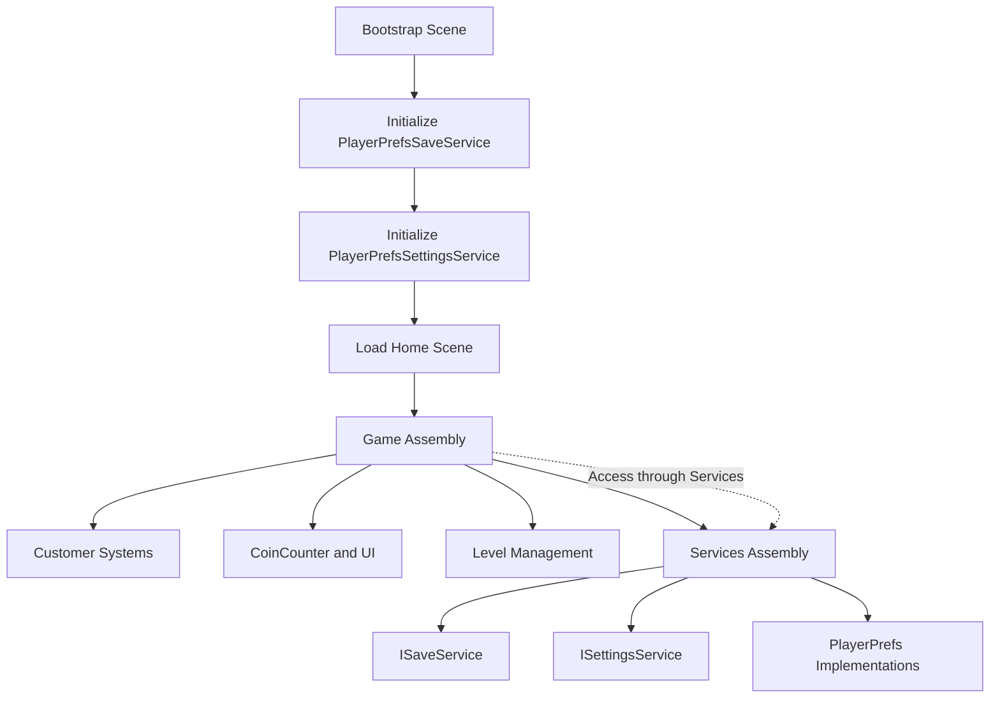

# Little Grocery Store

Team: [Yael Rosenblat] · [Chen Weiss] · [May Solomon] Course: Mobile Game Development, Shenkar

# The game in one sentence

Managing a grocery store. Ensuring the shelves are full and the customers are satisfied

## Architecture

## Assembly Structure

- **Game**: Gameplay, customer systems, UI, and level management.
- **Services**: Save and settings interfaces and their implementations.
- Game references Services.
- Services does not reference Game.

## Startup Flow

1. Unity opens the Bootstrap scene first.
2. Bootstrap initializes `PlayerPrefsSaveService`.
3. Bootstrap initializes `PlayerPrefsSettingsService`.
4. Bootstrap loads the Home scene.
5. Gameplay systems access services through the `Services` class.

## Economy Sheet

Our economy configuration includes:
- Level completion rewards
- Daily gifts
- Upgrade costs and progression
- Customer capacity upgrades

[View Little Grocery Store Economy Sheet](https://docs.google.com/spreadsheets/d/11UQHof8FsOIq1-wzbGSrVRxJUgRclG8tPhEiRDfmBps/edit?usp=sharing)

Economy balance check: Yes
Economy progression check: Yes